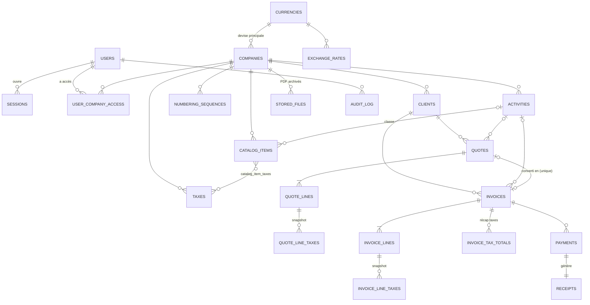

# Invoice Manager — Architecture (Phase 1)

> Statut : **implémentée (V1)** · Dernière mise à jour : 2026-11-09
> Ce document fixe les décisions techniques et le modèle de données de la V1.
> Toute modification significative passera par une mise à jour de la section « Décisions » (ADR).


> **Mise à jour 2026-11-14 — l'application est désormais une application web 100 % iPhone.**
> La section 0 ci-dessous décrit l'architecture en vigueur. Les sections suivantes décrivent la V1
> (serveur local sur Mac) : le modèle de données, les règles métier et le moteur de calcul restent
> valables et sont réutilisés tels quels ; les parties serveur, comptes, lanceur et sauvegardes
> serveur sont remplacées.

## 0. Architecture en vigueur : application iPhone (V2)

```
GitHub (dépôt public)  ──push──▶  GitHub Actions : types, tests, compilation  ──▶  GitHub Pages
                                                                                   (fichiers statiques)
iPhone (Safari / écran d'accueil)
 ├── Interface React (frontend/src)
 ├── Moteur local (frontend/src/local)
 │    ├── Mini-routeur compatible Fastify → exécute les modules métier de backend/src
 │    ├── SQLite en WebAssembly (sql.js) : même schéma, mêmes migrations, mêmes triggers
 │    ├── Enregistrement de la base dans IndexedDB AVANT chaque confirmation à l'écran
 │    └── PDF générés par pdfmake dans le navigateur (chargé à la demande)
 └── Service worker : application disponible hors connexion
```

| Sujet | Décision |
|---|---|
| Hébergement | GitHub Pages, publication par GitHub Actions à chaque push (`.github/workflows/pages.yml`) |
| Données | Uniquement sur l'appareil (IndexedDB) ; persistance demandée via `navigator.storage.persist()` |
| Comptes | Aucun : un seul utilisateur, protégé par le verrouillage de l'iPhone. Rôles et multi-utilisateurs retirés de l'interface |
| Fichiers | PDF et logos stockés dans la base (BLOB + SHA-256 vérifié) ; lecture binaire via SQLite brut (le pilote sql.js de Drizzle convertit les BLOB en texte) |
| PDF sur iPhone | Feuille de partage iOS (aperçu, Imprimer, Fichiers, Mail, AirDrop) ; sur ordinateur : aperçu + téléchargement |
| Sauvegardes | Export d'un fichier `.sqlite` complet via Partager ; restauration avec contrôle d'intégrité, version de schéma et copie de l'état précédent (annulable) ; rappel après 7 jours |
| Sécurité | CSP stricte (aucune connexion externe, `wasm-unsafe-eval` pour SQLite), aucun traceur, aucune requête réseau de données |
| Tests | 102 tests Vitest du noyau (banc de test Node, mêmes modules) + 8 étapes Playwright sur l'application compilée comme sur GitHub Pages (PDF, persistance, sauvegarde/restauration, hors connexion) |
| Limite connue | Effacer les données de Safari ou supprimer l'icône efface les données : l'export régulier est indispensable |

---

## 1. Environnement constaté

| Élément | Valeur constatée | Conséquence |
|---|---|---|
| Machine | MacBook Pro Intel i5-8257U (x86_64), 8 Go RAM | Pas de navigateur headless au runtime, un seul processus serveur |
| OS | macOS 15.8.1 (Sequoia) | Lanceur `.command` / `.app` natif possible |
| Node.js / npm | v24.22.0 (LTS) / 11.19.1 | Cible : Node ≥ 22, développé et testé sur 24 |
| Git | 2.39.5 — **identité (`user.name`/`user.email`) non configurée** | À configurer avant le premier commit |
| SQLite (système) | 3.43.2 | Non utilisé : `better-sqlite3` embarque sa propre version (FTS5, WAL, backup API) |
| Outils de build natifs | Command Line Tools présents | Permet de recompiler `better-sqlite3` si aucun binaire précompilé |
| Homebrew / pnpm / yarn | Absents | On reste sur **npm workspaces** (aucune installation système requise) |
| Disque | **13 Go libres** (volume Data à 94 %) | Risque n°1 — voir §11. Cache npm = 3,4 Go, cache Playwright = 449 Mo (déjà présent) |

---

## 2. Vue d'ensemble

Application **monolithique modulaire**, un seul processus Node.js local :

```
Navigateur (http://127.0.0.1:4300)
        │  HTML/JS statiques + API JSON (/api/v1)
        ▼
┌──────────────────────────── Processus Node.js (Fastify) ────────────────────────────┐
│  Middleware : en-têtes sécurité · session · contrôle d'origine · rate-limit login    │
│  Routes /api/v1  →  Modules métier (service + repository)  →  Drizzle ORM            │
│                      │            │                                                  │
│                      │            └─ moteur de calcul partagé (shared/: money, tax)  │
│                      ├─ PDF (pdfmake, polices embarquées)                            │
│                      ├─ Sauvegarde (SQLite online backup API, tar.gz, rotation)      │
│                      └─ Journal d'audit (append-only)                                │
└──────────────────────────────────────────┬───────────────────────────────────────────┘
                                           ▼
          ~/Library/Application Support/InvoiceManager/   (hors du code source)
            ├── data/invoice-manager.db   (SQLite, WAL)
            ├── documents/<entreprise>/<type>/<année>/*.pdf
            ├── backups/
            └── logs/
```

Principes directeurs :

1. **Le backend est la seule source de vérité.** Le frontend peut prévisualiser les totaux avec le même moteur de calcul (`shared/`), mais le backend **recalcule toujours** et ignore les totaux envoyés par le client.
2. **Isolation par entreprise à trois niveaux** : contrainte SQL (clés étrangères composites), couche repository (scope obligatoire), contrôle d'accès HTTP.
3. **Documents émis immuables** : protection applicative **et** triggers SQLite.
4. **Aucun appel réseau sortant** : pas de CDN, pas de Google Fonts, pas de télémétrie. Polices et icônes embarquées.
5. **Écoute sur `127.0.0.1` uniquement** par défaut. Le mode réseau local sera une option explicite (Phase ultérieure).
6. **Prêt pour l'empaquetage** : le serveur est une bibliothèque démarrable (`createApp(config)`), réutilisable tel quel dans Electron/Tauri ou sur un serveur.

---

## 3. Choix techniques

| Couche | Choix | Pourquoi (vs alternatives) |
|---|---|---|
| Monorepo | **npm workspaces** (`frontend`, `backend`, `shared`) | Natif, aucun outil à installer |
| Frontend | **React 19 + TypeScript + Vite + Tailwind CSS v4** | Conforme au cahier des charges |
| Composants | **shadcn/ui** (Radix UI copié dans le code) + **lucide-react** | Pas de bibliothèque runtime lourde ; composants accessibles et maîtrisés |
| Routage / données | **React Router** + **TanStack Query** | Cache serveur, invalidation, états de chargement cohérents |
| Formulaires | **React Hook Form + Zod** (schémas partagés) | Mêmes schémas front/back |
| Graphiques | **Histogrammes SVG maison** (une série par devise) | Aucune dépendance ajoutée ; Recharts écarté (poids) |
| i18n | **i18next / react-i18next** ; dictionnaires dans `shared/` | FR par défaut, EN prévu ; les PDF utilisent les mêmes dictionnaires |
| Backend | **Fastify 5** (plutôt qu'Express) | Plus léger et rapide, TypeScript natif, validation/sérialisation par schéma, `inject()` pour tester sans réseau |
| Base de données | **SQLite via `better-sqlite3`** | Synchrone (transactions simples et sûres), WAL, FTS5, **API de sauvegarde à chaud** intégrée |
| ORM | **Drizzle ORM + drizzle-kit** (plutôt que Prisma) | Pas de moteur binaire séparé, ~empreinte faible, SQL explicite, supporte les **clés étrangères composites**, migrations SQL lisibles et versionnées |
| Validation | **Zod 4** | Schémas partagés dans `shared/schemas` |
| PDF | **pdfmake 0.2** (côté serveur, police Roboto embarquée) | 100 % JS, local, tableaux avec en-têtes répétés sur plusieurs pages, pas de Chromium (Puppeteer = ~300 Mo disque + RAM élevée) |
| Mots de passe | **`crypto.scrypt` natif Node** | Aucune dépendance native supplémentaire (argon2/bcrypt) |
| Tests | **Vitest** (unitaires + intégration via `fastify.inject`) · **Playwright 1.47.2** (Chromium seul, 1 worker) | Version alignée sur le Chromium déjà en cache (aucun téléchargement) |
| Exécution TS | `tsx` en dev, **tsup** (esbuild) pour le build | Rapide, peu de RAM |

Les versions seront **figées exactement** (pas de `^`) et un `package-lock.json` sera versionné.

---

## 4. Structure du projet

Structure proche de celle proposée, avec deux adaptations justifiées :
- `data/`, `backups/`, `documents/` **ne sont pas dans le dépôt** : ils vivent dans le répertoire de données (§9) pour survivre aux mises à jour et ne jamais être commités.
- Les modules métier backend sont regroupés **par domaine** (routes + service + repository + tests ensemble) plutôt que par couche technique.

```
invoice-manager/
├── package.json                 # workspaces + scripts racine (dev, build, start, test, backup…)
├── Invoice Manager.command      # lanceur macOS (double-clic)
├── ARCHITECTURE.md · ROADMAP.md · README.md · docs/decisions/
├── scripts/                     # start.mjs, backup.mjs, restore.mjs, reset-password.mjs, seed-demo.mjs
├── shared/
│   └── src/
│       ├── money/               # Money (unités mineures, BigInt), arrondis, formatage
│       ├── tax/                 # moteur fiscal pur (lignes, remises, taxes, TTC/HT)
│       ├── schemas/             # schémas Zod (entrées API)
│       ├── types/               # DTO partagés
│       ├── constants/           # statuts, modes de paiement, transitions autorisées
│       └── i18n/                # fr.json, en.json
├── backend/
│   └── src/
│       ├── app.ts               # createApp(config) — réutilisable (desktop/serveur)
│       ├── server.ts            # point d'entrée CLI
│       ├── config/              # profils (prod/dev/demo/test), chemins
│       ├── database/            # schema.ts (Drizzle), migrations/, triggers.sql, connexion
│       ├── middleware/          # auth, companyScope, origin-check, error handler
│       ├── modules/
│       │   ├── auth/  users/  companies/  activities/  currencies/  taxes/
│       │   ├── clients/  catalog/  quotes/  invoices/  payments/  receipts/
│       │   ├── numbering/  search/  dashboard/  audit/  backup/  documents/
│       │   └── <module>/{routes.ts, service.ts, *.test.ts}  (accès aux données toujours filtré par company_id)
│       ├── pdf/                 # templates quote.ts, invoice.ts, receipt.ts, fonts/
│       └── utils/
├── frontend/
│   └── src/
│       ├── components/ui/       # design system (shadcn)
│       ├── components/          # composants transverses (DataTable, MoneyInput, LineEditor…)
│       ├── layouts/             # AppShell (sidebar, topbar, recherche globale)
│       ├── pages/  modules/  hooks/  services/ (client API)  contexts/  i18n/  styles/
└── tests/
    └── e2e/                     # Playwright
```

---

## 5. Hiérarchie organisationnelle

```
ORGANISATION (l'installation : réglages globaux, utilisateurs, devises, taux de change)
 └── ENTREPRISE (isolée : coordonnées, logo, fiscalité, numérotation, devise principale)
      ├── ACTIVITÉS (sous-divisions : « Formation », « Conseil », …)
      ├── CLIENTS
      ├── CATALOGUE (produits / prestations, rattachables à une activité)
      └── DOCUMENTS (devis → factures → paiements → reçus), rattachables à une activité
```

- Une installation = **une organisation** (pas de multi-organisation en V1).
- Les **utilisateurs** appartiennent à l'organisation et reçoivent un accès **par entreprise** (`admin`, `editor`, `viewer`). Le propriétaire (`owner`) a accès à tout.
- L'entreprise active figure **dans l'URL** (`/c/:companyId/...`) et dans chaque route API (`/api/v1/companies/:companyId/...`) : aucun état « entreprise courante » caché qui pourrait fuiter d'un écran à l'autre.

---

## 6. Modèle de données

### 6.1 Conventions

- **Identifiants** : UUID v7 (texte, triables chronologiquement).
- **Montants** : `INTEGER` en **unités mineures** de la devise (`CAD 12,34 $ → 1234`, `XOF 5 000 → 5000` car XOF n'a pas de décimales). Colonnes suffixées `_minor`.
- **Quantités** : `INTEGER` en millièmes (`quantity_milli` : 1,5 h → 1500).
- **Taux de taxe et pourcentages** : `INTEGER` en parties par million (`rate_ppm` : 5 % → 50 000 ; 9,975 % → 99 750).
- **Taux de change** : `TEXT` décimal exact (`"0.6812"`), utilisés uniquement pour les rapports.
- **Dates métier** : `TEXT 'YYYY-MM-DD'` (date locale, sans fuseau). **Horodatages** : `TEXT` ISO-8601 UTC.
- Les calculs intermédiaires utilisent `BigInt` ; aucun `float` n'intervient dans un montant.
- Toute table métier porte `company_id` + `UNIQUE(company_id, id)` pour permettre les **clés étrangères composites** : une facture ne peut référencer un client que **de la même entreprise**, garanti par SQLite lui-même.
- Archivage logique (`archived_at`) ; aucune suppression physique de données métier émises.

### 6.2 Diagramme entité-relation



### 6.3 Tables

**Organisation & accès**

| Table | Colonnes principales | Notes |
|---|---|---|
| `app_meta` | `key`, `value` | version du schéma, id d'installation, profil |
| `org_settings` | ligne unique : `name`, `default_locale`, `reporting_currency`, `backup_*`, `session_idle_minutes` | |
| `users` | `id`, `email` (unique), `display_name`, `password_hash`, `role` (`owner`/`member`), `locale`, `theme`, `is_active`, `last_login_at` | scrypt + sel |
| `sessions` | `id_hash` (SHA-256 du jeton), `user_id`, `created_at`, `last_seen_at`, `expires_at`, `user_agent` | le jeton brut n'est jamais stocké |
| `user_company_access` | `user_id`, `company_id`, `role` (`admin`/`editor`/`viewer`) | PK composite |

**Référentiels**

| Table | Colonnes principales | Notes |
|---|---|---|
| `currencies` | `code` (PK, ISO 4217), `name`, `symbol`, `minor_units`, `is_active` | Seed : CAD (2), EUR (2), XOF (0) ; ajout libre |
| `exchange_rates` | `id`, `base_code`, `quote_code`, `rate` (TEXT décimal), `effective_date`, `created_by` | **Rapports uniquement**, jamais appliqué aux documents |
| `companies` | `id`, `legal_name`, `trade_name`, `logo_file_id`, adresse (`line1`, `line2`, `city`, `region`, `postal_code`, `country`), `phone`, `email`, `website`, `legal_ids` (JSON : NEQ, SIRET, RCCM, NINEA…), `default_currency`, `default_locale`, `payment_terms_days`, `quote_validity_days`, `prices_include_tax`, `tax_rounding` (`per_line`/`per_document`), `bank_details`, `legal_footer`, `default_terms`, `archived_at` | |
| `activities` | `id`, `company_id`, `name`, `code`, `description`, `color`, `archived_at` | `UNIQUE(company_id, name)` |
| `taxes` | `id`, `company_id`, `name` (TPS, TVQ, TVA 20 %…), `code`, `rate_ppm`, `is_compound`, `registration_number`, `jurisdiction`, `is_default`, `archived_at` | **aucun taux en dur** ; préréglages proposés à la création (modifiables) |
| `numbering_sequences` | `company_id`, `doc_type` (`quote`/`invoice`/`receipt`/`credit_note`), `pattern` (ex. `FAC-{YYYY}-{SEQ:5}`), `reset` (`yearly`/`never`), `period_key`, `next_value` | incrément dans la transaction d'émission |

**Commercial**

| Table | Colonnes principales | Notes |
|---|---|---|
| `clients` | `id`, `company_id`, `type` (`individual`/`business`), `name`, `contact_name`, adresse, `country`, `phone`, `email`, `tax_ids` (JSON `[{label, value}]`), `tax_exempt`, `exemption_ref`, `preferred_locale`, `preferred_currency`, `notes`, `archived_at` | solde calculé, jamais stocké en dur |
| `catalog_items` | `id`, `company_id`, `activity_id?`, `kind` (`product`/`service`), `sku` (`UNIQUE(company_id, sku)`), `name`, `description`, `category`, `unit` (unité, heure, jour, forfait…), `unit_price_minor`, `currency`, `price_includes_tax`, `tax_treatment` (`taxable`/`zero_rated`/`exempt`), `archived_at` | modifier le prix n'affecte **jamais** les lignes existantes (copie) |
| `catalog_item_taxes` | `catalog_item_id`, `tax_id` | taxes par défaut de l'article |

**Documents**

| Table | Colonnes principales | Notes |
|---|---|---|
| `quotes` | `id`, `company_id`, `client_id`, `activity_id?`, `number` (`UNIQUE(company_id, number)`), `status`, `currency`, `locale`, `issue_date`, `valid_until`, `prices_include_tax`, `doc_discount_type/value`, totaux (`subtotal_minor`, `discount_minor`, `taxable_base_minor`, `tax_total_minor`, `total_minor`), `terms`, `notes`, `client_snapshot`, `company_snapshot`, `duplicated_from_id?`, `converted_invoice_id?`, `sent_at`, `decided_at`, `version` | |
| `quote_lines` / `invoice_lines` | `id`, `company_id`, `document_id`, `position`, `catalog_item_id?` (traçabilité seulement), `sku`, `name`, `description`, `unit`, `quantity_milli`, `unit_price_minor`, `discount_type` (`percent`/`amount`), `discount_value`, `tax_treatment`, `gross_minor`, `discount_minor`, `net_minor`, `tax_minor`, `total_minor` | valeurs **copiées**, jamais référencées |
| `quote_line_taxes` / `invoice_line_taxes` | `line_id`, `tax_id?`, `name`, `rate_ppm`, `is_compound`, `registration_number`, `base_minor`, `amount_minor` | **snapshot** fiscal |
| `invoices` | mêmes champs que `quotes` + `due_date`, `payment_terms`, `source_quote_id?` (**UNIQUE**), `status` (`draft`/`issued`/`cancelled`), `number` (NULL tant que brouillon), `issued_at`, `amount_paid_minor` (cache transactionnel), `cancelled_at`, `cancel_reason`, `pdf_file_id` | |
| `invoice_tax_totals` | `invoice_id`, `name`, `rate_ppm`, `registration_number`, `base_minor`, `amount_minor` | récapitulatif par taxe affiché sur le PDF |
| `payments` | `id`, `company_id`, `invoice_id`, `client_id`, `payment_date`, `amount_minor`, `currency` (= devise facture), `method` (`bank_transfer`/`cash`/`card`/`cheque`/`other`), `reference`, `notes`, `status` (`recorded`/`voided`), `void_reason`, `idempotency_key` (UNIQUE), `created_by` | |
| `receipts` | `id`, `company_id`, `payment_id` (UNIQUE), `number`, `issue_date`, `amount_minor`, `balance_before_minor`, `balance_after_minor`, `is_full_payment`, `snapshot`, `status` (`valid`/`void`), `pdf_file_id` | créé dans la **même transaction** que le paiement |

**Transverse**

| Table | Colonnes principales | Notes |
|---|---|---|
| `stored_files` | `id`, `company_id`, `kind` (`logo`/`pdf`), `entity_type`, `entity_id`, `rel_path`, `sha256`, `size`, `created_at` | PDF des documents émis archivés une fois pour toutes |
| `audit_log` | `id`, `at`, `user_id`, `company_id?`, `action`, `entity_type`, `entity_id`, `summary`, `changes` (JSON avant/après) | **append-only** (triggers bloquant UPDATE/DELETE) |
| `search_index` | table virtuelle **FTS5** : `company_id`, `entity_type`, `entity_id`, `title`, `body` | recherche globale, toujours filtrée par entreprise accessible |

### 6.4 Garde-fous au niveau base

- `PRAGMA foreign_keys = ON`, `journal_mode = WAL`, `busy_timeout = 5000`, `synchronous = NORMAL`.
- **Clés étrangères composites** `(company_id, client_id) → clients(company_id, id)` etc. sur toutes les relations inter-entités.
- **Triggers d'immutabilité** : `BEFORE UPDATE ON invoices WHEN OLD.status <> 'draft'` → seules les colonnes de suivi (`amount_paid_minor`, `status → cancelled`, `pdf_file_id`) peuvent changer ; idem pour les lignes et taxes d'une facture non brouillon (`RAISE(ABORT)`). `BEFORE DELETE` interdit sur facture émise.
- Contraintes `CHECK` : montants ≥ 0, `amount_paid_minor ≤ total_minor`, statuts dans la liste autorisée.

---

## 7. Règles métier

### 7.1 Monnaie et calculs (module `shared/money` + `shared/tax`)

1. Pour chaque ligne : `brut = quantité × prix unitaire` → `remise ligne` → `net`.
2. La **remise document** (pourcentage ou montant) est **répartie au prorata** des nets de ligne (méthode du plus fort reste, pour que la somme tombe juste au centime) — la base taxable reste ainsi correcte par taxe.
3. Taxes : chaque ligne porte 0..n taxes. Taxes simples calculées sur le net ; taxe composée (`is_compound`) calculée sur net + taxes simples. `zero_rated` (détaxé, taux 0 mais déclaré) et `exempt` (exonéré, hors champ) sont distingués à l'affichage.
4. Arrondi : **demi-unité supérieure (arrondi commercial)** à l'unité mineure ; mode de taxation `per_document` (par défaut : bases cumulées par taxe puis arrondies une fois) ou `per_line`, paramétrable par entreprise.
5. **Prix TTC** : si `prices_include_tax`, le net HT est déduit par division exacte (`BigInt`) puis la taxe = TTC − HT, pour que le total TTC affiché reste exactement le prix saisi.
6. Affichage séparé : **Sous-total · Remises · Base taxable · Détail des taxes (par taux) · Total TTC**.
7. Client exonéré (`tax_exempt`) → taxes forcées à `exempt` avec mention de la référence d'exonération.

### 7.2 Devises

- Chaque document a **sa** devise (par défaut celle de l'entreprise, modifiable en brouillon). Un document n'est **jamais** converti.
- Un article du catalogue dans une autre devise que le document : ajout refusé avec message clair (ou saisie manuelle du prix) — pas de conversion implicite.
- Paiement **dans la devise de la facture** uniquement.
- Rapports : agrégés **par devise**. Vue « convertie » optionnelle : taux manuels de `exchange_rates` (taux applicable à la date du document ou dernier taux connu, au choix) — la devise de référence, le taux et sa date sont affichés.

### 7.3 Numérotation

- Motif configurable par entreprise et par type : `{PREFIX}`, `{YYYY}`, `{YY}`, `{MM}`, `{SEQ:n}`. Défauts : `DEV-{YYYY}-{SEQ:4}`, `FAC-{YYYY}-{SEQ:5}`, `REC-{YYYY}-{SEQ:5}`.
- **Facture** : numéro attribué **à l'émission**, dans la transaction d'émission → séquence **continue et sans trou** (exigence légale fréquente). Les brouillons affichent « Brouillon ».
- **Devis** : numéro attribué à la création (un devis abandonné passe en « Annulé », jamais supprimé).
- **Reçu** : numéro attribué à l'enregistrement du paiement.
- Unicité garantie par `UNIQUE(company_id, number)` ; la séquence est verrouillée par la transaction SQLite (écrivain unique).

### 7.4 Cycle de vie des devis

```
brouillon ──envoyer──▶ envoyé ──accepter──▶ accepté ──convertir──▶ (facture brouillon liée)
   │                     │ ├──refuser──▶ refusé
   │                     │ └──(date dépassée)──▶ expiré*
   └──annuler──▶ annulé ◀┘
* « Expiré » est dérivé (envoyé + valid_until < aujourd'hui) ; il peut être figé explicitement.
```

- Modifiable **uniquement en brouillon**. Duplication possible depuis n'importe quel statut (nouveau brouillon, `duplicated_from_id`).
- **Conversion idempotente** : transaction qui vérifie `converted_invoice_id IS NULL`, crée la facture avec `source_quote_id` (**UNIQUE**). Un double clic renvoie la facture déjà créée (HTTP 200 avec la même ressource), jamais un doublon. Bouton désactivé côté UI en complément.

### 7.5 Cycle de vie des factures

Statut stocké : `draft → issued → cancelled`. Statut **affiché** dérivé :

| Affiché | Condition |
|---|---|
| Brouillon | `status = draft` |
| Émise | `issued`, `amount_paid = 0`, non échue |
| Partiellement payée | `issued`, `0 < amount_paid < total` |
| Payée | `issued`, `amount_paid = total` |
| En retard | `issued`, `amount_paid < total`, `due_date < aujourd'hui` |
| Annulée | `cancelled` |

Dériver « En retard » évite une tâche planifiée et toute incohérence.

- **Émission** (transaction unique) : recalcul définitif, attribution du numéro, snapshots client / entreprise / taxes, génération et archivage du PDF (hash SHA-256), journalisation, indexation recherche.
- **Facture émise = figée.** Correction : annulation motivée (journalisée), puis « Dupliquer en nouveau brouillon ». Une facture ayant des paiements actifs ne peut pas être annulée. **Notes de crédit (avoirs)** : prévues en V2 (table `credit_notes`, type de séquence déjà réservé).
- Suppression : uniquement les **brouillons**, journalisée.
- Les taxes d'un brouillon sont copiées à l'enregistrement (taux, numéro d'inscription) : l'émission fige exactement ce que l'utilisateur a relu, sans recalcul silencieux. Modifier un brouillon réapplique les taux en vigueur.
- Recherche : insensible à la casse et aux accents (fonction SQLite `im_norm`), requêtes toujours paramétrées.

### 7.6 Paiements et reçus

- Facture `issued` obligatoire ; `0 < montant ≤ solde restant` ; devise = devise facture ; date ≥ date d'émission ; validation **backend**.
- Une transaction : insertion paiement → mise à jour `amount_paid_minor` → reçu numéroté (partiel ou intégral, solde avant/après) → audit. `idempotency_key` empêche le double enregistrement (double clic, rechargement).
- Correction d'un paiement : **annulation** (statut `voided`, motif, reçu marqué « ANNULÉ »), jamais de suppression. Remboursements / trop-perçus : V2 avec les avoirs.

### 7.7 Isolation des entreprises

1. **HTTP** : middleware `companyScope` — vérifie que l'utilisateur a accès à `:companyId` et son rôle pour l'action (lecture/écriture/admin) ; sinon 404 (ne révèle pas l'existence).
2. **Repository** : chaque méthode exige un `CompanyScope` en premier argument ; toutes les requêtes filtrent `company_id`. Pas d'accès « par id seul ».
3. **SQL** : clés étrangères composites (une ligne ne peut pas pointer vers une entité d'une autre entreprise).
4. **Tests dédiés** : tentative de lecture/modification croisée sur chaque ressource → 404, et tentative d'insertion croisée directe → échec SQL.

---

## 8. API (aperçu)

REST JSON versionnée, entrées validées par Zod, erreurs normalisées `{ error: { code, message, details } }`.

```
POST   /api/v1/auth/setup | login | logout          GET /api/v1/auth/me
GET    /api/v1/companies                             POST /api/v1/companies
GET    /api/v1/dashboard                             (consolidé, par devise)
GET    /api/v1/search?q=                             (toutes entreprises accessibles)
/api/v1/companies/:cid/
   activities · taxes · clients · catalog · numbering
   quotes          POST :id/send|accept|refuse|cancel|duplicate|convert
   invoices        POST :id/issue|cancel|duplicate
   payments        POST :id/void
   receipts
   */:id/pdf       GET (aperçu inline / téléchargement ?download=1)
   dashboard
/api/v1/admin/  users · currencies · exchange-rates · backups (list, create, export, restore) · audit
GET    /api/health
```

---

## 9. Données, profils et sauvegardes

### 9.1 Répertoires

| Profil | Répertoire | Usage |
|---|---|---|
| `prod` (défaut de `npm start`) | `~/Library/Application Support/InvoiceManager/` | Données réelles |
| `dev` (`npm run dev`) | `~/Library/Application Support/InvoiceManager-dev/` | Développement |
| `demo` (`npm run demo`) | `~/Library/Application Support/InvoiceManager-demo/` | Données de démonstration, **bandeau « DÉMO » permanent** |
| `test` | dossier temporaire créé/détruit par test | Tests automatisés |

Surchargeable par `INVOICE_MANAGER_DATA_DIR`. **Les données de démonstration ne cohabitent jamais avec les données réelles** (bases distinctes), ce qui respecte aussi la règle « ne jamais supprimer les données de production pendant le développement ».

### 9.2 Sauvegardes

- **Mécanisme cohérent** : API *online backup* de SQLite (`db.backup()`), sûre même pendant les écritures en WAL — jamais de simple copie de fichier.
- **Automatiques** : au démarrage si la dernière date de plus de 24 h, toutes les 24 h tant que l'app tourne, **avant chaque migration** et **avant chaque restauration**.
- **Rotation** : 7 quotidiennes, 4 hebdomadaires, 12 mensuelles (paramétrable).
- **Format** : `backups/2026-11-09T10-43-00Z/` → `invoice-manager.db` + `manifest.json` (version app, version schéma, SHA-256, nombre d'enregistrements).
- **Export manuel** (`npm run backup` ou UI) : archive `.tar.gz` = base + dossier `documents/` + manifeste ; destination configurable (ex. disque externe).
- **Restauration** : vérification du manifeste et du hash → ouverture en lecture seule + `PRAGMA integrity_check` → migration si schéma plus ancien (refus si plus récent) → sauvegarde de sécurité de l'état actuel → fermeture, remplacement atomique (`rename`), réouverture.

---

## 10. Sécurité

| Sujet | Mesure |
|---|---|
| Exposition réseau | Écoute `127.0.0.1` uniquement ; option LAN désactivée (future : opt-in + HTTPS + liste d'hôtes) |
| Premier lancement | Assistant de création du compte propriétaire ; **aucun mot de passe par défaut** |
| Mots de passe | scrypt (N=2^15) + sel aléatoire, comparaison à temps constant ; `npm run reset-password` en local |
| Sessions | Jeton aléatoire 256 bits en cookie `HttpOnly`, `SameSite=Strict`, `Path=/` ; seul le hash est stocké ; expiration d'inactivité (12 h par défaut) ; invalidation au logout et au changement de mot de passe |
| CSRF | `SameSite=Strict` + vérification de l'en-tête `Origin` + en-tête personnalisé obligatoire sur les requêtes mutantes |
| Injections | Requêtes paramétrées (Drizzle), aucune concaténation SQL ; échappement FTS5 des requêtes de recherche ; React échappe le HTML |
| Validation | Zod sur toutes les entrées ; tailles max (logo ≤ 2 Mo, PNG/JPEG vérifiés par signature) |
| Brute force | Limitation des tentatives de connexion |
| En-têtes | CSP stricte (`default-src 'self'`), `X-Content-Type-Options`, `Referrer-Policy`, `frame-ancestors 'self'` |
| Fichiers | Chemins générés côté serveur uniquement (pas de chemin fourni par l'utilisateur) ; permissions `0700` sur le répertoire de données |
| Traçabilité | Journal d'audit append-only : connexion, création/modification/émission/annulation, paiements, sauvegardes, restaurations |

---

## 11. Risques identifiés

| # | Risque | Impact | Mesure |
|---|---|---|---|
| R1 | **Espace disque : 13 Go libres** (94 % utilisé) | Install bloquée, base/sauvegardes corrompues si disque plein | `node_modules` estimé 500–700 Mo ; vérification d'espace avant chaque sauvegarde avec alerte ; rotation ; Chromium Playwright déjà en cache. Recommandation : `npm cache clean --force` libérerait ~3,4 Go |
| R2 | 8 Go RAM | Lenteurs en dev | Pas de Chromium au runtime (pdfmake) ; tests Playwright à 1 worker ; un seul processus |
| R3 | Module natif `better-sqlite3` sur Intel + Node 24 | Échec d'installation | Binaires précompilés darwin-x64 normalement disponibles ; CLT présent pour compiler ; vérifié en tout premier en Phase 2. Repli possible : `node:sqlite` intégré |
| R4 | **Conformité légale** variable selon le pays (mentions obligatoires Québec/Canada, France, zone UEMOA/OHADA) | Factures non conformes | Champs légaux paramétrables, mentions personnalisables, revue par votre comptable. **France : la réforme de la facturation électronique (réception obligatoire dès sept. 2026, émission PME en sept. 2027) exige un format structuré (Factur-X/UBL) via plateforme agréée — hors périmètre V1**, à planifier si une entreprise est française |
| R5 | Erreurs d'arrondi / cas fiscaux (TTC, taxes composées, remise globale) | Montants faux | Moteur pur en `BigInt`, batterie de cas de référence (TPS+TVQ, TVA 20 %/5,5 %, XOF sans décimales, TTC) |
| R6 | Erreur sur facture émise sans avoir (V1) | Blocage utilisateur | Annulation motivée + duplication ; avoirs en V2 (prévu dans le schéma). En France, l'annulation d'une facture émise doit en principe passer par un avoir → à prioriser si concerné |
| R7 | Accès concurrent à la base (deux instances) | Verrous, corruption | Fichier PID + verrou au démarrage ; la CLI de sauvegarde utilise l'API de backup (sûre en parallèle) |
| R8 | Sauvegardes sur le même disque | Perte totale en cas de panne disque | Destination d'export configurable (disque externe), rappel dans l'UI ; Time Machine recommandé |
| R9 | Dépendances très récentes (React 19, Vite 8, Zod 4, React Router 8…) | Incompatibilités | Versions figées, lockfile, montée de version contrôlée |
| R10 | Identité Git non configurée | Commits impossibles | À configurer (nom + e-mail) avant le premier commit |
| R11 | Ampleur du projet | Livraison partielle | Phases validées une à une, critères de sortie testés (ROADMAP.md) |

---

## 12. Décisions (ADR résumées)

| ID | Décision | Statut |
|---|---|---|
| ADR-001 | Monolithe modulaire, un processus, npm workspaces | Retenu |
| ADR-002 | Fastify plutôt qu'Express | Retenu |
| ADR-003 | SQLite + better-sqlite3 + Drizzle plutôt que Prisma | Retenu |
| ADR-004 | Montants en entiers (unités mineures), calculs BigInt, taux en ppm | Retenu |
| ADR-005 | Isolation entreprise par FK composites + scope repository + middleware | Retenu |
| ADR-006 | Numéro de facture attribué à l'émission (séquence sans trou) | Retenu |
| ADR-007 | Statuts « En retard » / « Expiré » dérivés, non stockés | Retenu |
| ADR-008 | PDF via pdfmake côté serveur, PDF des documents émis archivés et hachés | Retenu |
| ADR-009 | Données hors du dépôt, profils prod/dev/demo/test séparés | Retenu |
| ADR-010 | Authentification locale scrypt + sessions serveur, écoute 127.0.0.1 | Retenu |
| ADR-011 | Avoirs, Factur-X, mode réseau, modèles PDF personnalisables : hors V1 | Retenu |
| ADR-012 | Recherche globale par balayage indexé insensible aux accents (`im_norm`) plutôt que FTS5 : suffisant pour les volumes locaux, sans index à maintenir. La table FTS5 reste disponible | Retenu |
| ADR-013 | Tableaux de bord : CA = somme HT des factures émises (par date d'émission) ; encaissé = paiements non annulés (par date de paiement) ; aucune addition entre devises, conversion facultative par taux manuels affichés | Retenu |
| ADR-014 | PDF des factures émises et reçus archivés une seule fois avec SHA-256 vérifié à chaque lecture ; le PDF archivé est l'original (paiements ultérieurs non reportés) | Retenu |
| ADR-015 | Serveur lancé avec `--max-semi-space-size=4` : empreinte mémoire ~80–100 Mo au lieu de ~260 Mo | Retenu |
| ADR-016 | Exports dans `<données>/exports` (ou dossier choisi) ; restauration : vérification d'empreinte, `integrity_check`, version de schéma, sauvegarde de sécurité puis remplacement atomique | Retenu |

---

## 13. Bilan V1 (2026-11-09)

- **Tests** : 109 tests Vitest (moteur fiscal, isolation, triggers, numérotation, parcours commercial, PDF, tableaux de bord, recherche, sauvegardes, sécurité) + 8 étapes Playwright de bout en bout.
- **Mesures sur la machine cible** (Intel i5, 8 Go) : démarrage ≈ 2 s ; empreinte mémoire ≈ 80 Mo au repos ; tableau de bord ≈ 20 ms par requête sur la base de démonstration (28 factures, 3 entreprises).
- **Audit des dépendances** : aucune vulnérabilité en production. 4 alertes « modérées » en développement uniquement (ancien esbuild embarqué par drizzle-kit ; la fonction concernée — serveur de développement esbuild — n'est pas utilisée).
- **Hors V1** : notes de crédit, facturation électronique structurée (Factur-X), modèles PDF personnalisables, mode réseau local, empaquetage desktop.
